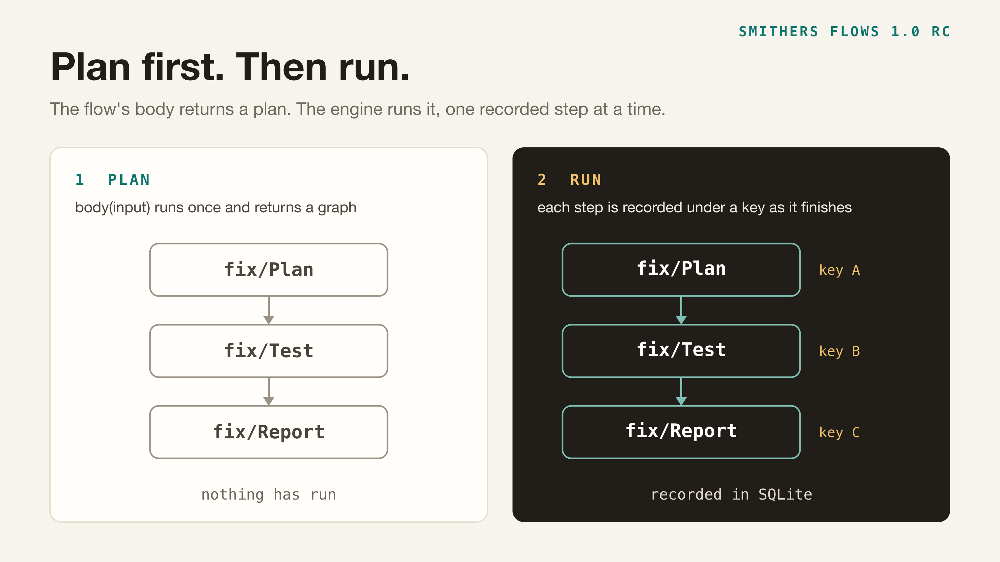
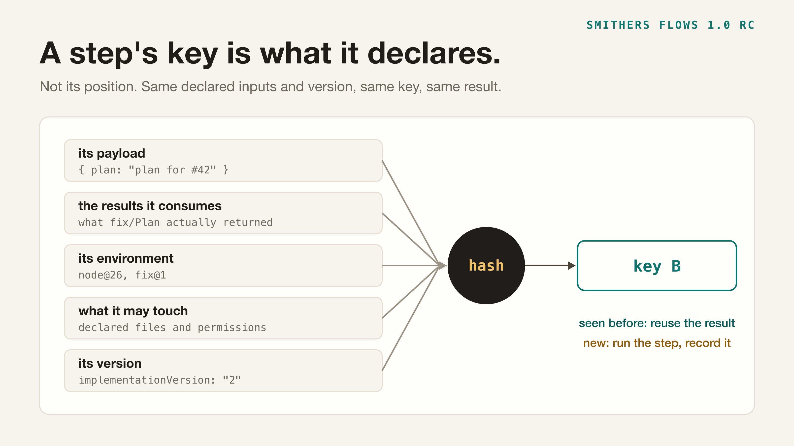

Smithers Flows is built for backpressure: the tests, lint and checks that keep coding agents honest. That job needs a cache you can trust, a record you can rewind, and a plan you can read before anything runs.

Two design decisions produce all three. A flow is planned before it runs, and a step is identified by what it reads. This page explains both, with output from the published release candidate, 1.0.0-rc.9.

## A flow is a plan

Here is a flow with three steps. `step` is the helper shown under [What makes reuse safe](#what-makes-reuse-safe) below.

```ts
import { Flow, Plan as P } from "@smthrs/flows"
import * as Schema from "effect/Schema"

const then = P.Node.bindPlanned

const Plan = step("fix/Plan", { issue: Schema.String })
const Test = step("fix/Test", { plan: Schema.String })
const Report = step("fix/Report", { result: Schema.String })

const Fix = Flow.make("fix/Fix", {
  payload: { issue: Schema.String },
  success: Schema.String,
  body: (input) =>
    Plan.call(input).pipe(
      then((plan) => Test.call({ plan })),
      then((result) => Report.call({ result }))
    )
})
```

This block is a fragment: the step code, the host and the `--plan` flag are left out. [Change a flow and keep the work](../guides/change-a-flow-and-keep-the-work.md) has a complete program like it.

A step is declared as data: a name, what it takes, and what it returns. The code that calls the model or runs the tests attaches separately.

The `body` looks like a function that does the work. It does not. It runs once, before any step, and returns a graph: which steps exist, what each one receives, and what depends on what.



Inside the body, a step's result does not exist yet. `plan` and `result` above are placeholders. You can pass a placeholder to the next step. Computing with one, such as `+`, a template string or `JSON.stringify`, stops the build and tells you what to do instead. An `if` on a placeholder is always true, so decide with [`Node.branch`](../../flow/docs/guides/build-a-body.md#decide-between-two-continuations):

```text
GraphBuildError [@smthrs/plan/GraphBuildError]: Planned value root.flow.andThen was computed at plan time by toJSON. Use Node.map to compute, Node.branch to decide, or pass the value into a payload.
```

Decisions are part of the plan as well. A branch stores both of its arms, and a fan-out fixes its width when the plan is built.

### What the plan gives you

Because the plan is a value, you can ask for it without running anything: a dry run.

```bash
node fix.ts --plan
```

```text
will run  fix/Plan
will run  fix/Test
will run  fix/Report
3 steps planned. Nothing has run.
```

No model is called and no file is written. You can print the plan and put it in front of a person before anything runs. A plan only grows: new steps are appended, and a step already in it is never replaced.

## A step is identified by what it reads

Each step in the plan gets a key: a hash of what the step declares can change its result.



- Its payload.
- The results it consumes from earlier steps.
- Its environment: the runtime, tool and capability names the program declares. Smithers does not check them.
- What it may touch: the file boundary it declares.
- Its version. A step's code is not in the key: when you change what a step does, bump its `implementationVersion` and it runs again.

The key does not depend on where the step sits in the flow. The helper below puts the step's name in the key, so a renamed step runs once more.

When the engine reaches a step, it looks the key up. If a result is recorded under that key, the engine returns it. If not, it runs the step and records the result.

That one rule covers every case below. Each of them was run on the published package.

| What changed                   | plan   | test   | report | Steps that ran |
| ------------------------------ | ------ | ------ | ------ | -------------- |
| Restart after a crash          | reused | ran    |        | 1 of 2         |
| Add a step                     | reused | reused | ran    | 1 of 3         |
| Edit the middle step           | reused | ran    | reused | 1 of 3         |
| First step reruns, same output | ran    | reused | reused | 1 of 3         |
| Change the input               | ran    | ran    | ran    | 3 of 3         |

### The row that surprises people

Look at the fourth row. The first step ran again and the two steps after it did not.

A step's key is computed when the step is about to run, from the content its inputs produced. The first step returned the same bytes as before, so the steps after it saw the same inputs and had nothing to do.

The third row is the same rule seen from the other side. The middle step was edited and its version bumped, so it ran again. It returned the same result, so the report step did not run.

## Why you can edit a workflow

Many durable execution engines record a history of what a run did and replay it. That works as long as the code makes the same calls in the same order as the recording. Edit the code and the old recording no longer lines up, so you version the workflow by hand.

Smithers has no order to line up with. When you edit a flow and run it again, each step is looked up by its key. A step whose inputs did not change has the same key under the new code as it had under the old code. Bump a step's version when you change its code. That step runs again, and so does any later step whose input it changes.

## Why you can trust a cache hit

Build systems like Bazel earned their reputation on one property: a cache hit is not a false positive. When Bazel skips an action, the action's declared inputs and command really did not change, because Bazel hashes them, and its sandbox hides undeclared files from the action.

Smithers applies the same idea to workflow steps. A step that opts into reuse declares a key, a file boundary and an environment. With a hard boundary, Smithers refuses file access the step did not declare, so a step cannot quietly depend on a file its key does not cover.

One gap is yours to close: the key does not include the step's code. When you change what a step does, bump its `implementationVersion`.

## What makes reuse safe

Reusing a result in a later run is a strong claim, so each step opts in with three declarations.

1. **A key the next run can derive.** The step's `idempotencyKey`.
2. **A file boundary.** The files the step reads and writes, enforced so that undeclared access is rejected.
3. **A complete environment.** The runtime, tool and capability names the program runs under. Smithers trusts what you declare.

Leave one out and the result is scoped to the run that produced it. That is the default, and it is safe: a half-declared environment would let a result computed under one toolchain be served to a run under another.

This is the helper the examples use, a fragment of the same program:

```ts
import { Action } from "@smthrs/flows"
import * as Schema from "effect/Schema"

const step = <const Tag extends string, F extends Schema.Struct.Fields>(tag: Tag, payload: F) =>
  Action.withCache(
    Action.make(tag, {
      payload,
      success: Schema.String,
      idempotencyKey: (input: unknown) => ({ step: tag, input: input as never }),
      fileBoundary: { readSet: [], writeSet: [], boundaryMode: "hard" }
    }),
    { scope: "shared" }
  )
```

Not every step should be reused. A step also declares a tier, which tells the engine what running it twice would mean.

| Tier           | Use it when                                     | What the engine does                                                          |
| -------------- | ----------------------------------------------- | ----------------------------------------------------------------------------- |
| `sealed`       | The result depends only on the declared inputs. | Records the result, and reuses it across runs when the step opts in.          |
| `compensable`  | The step changes the workspace.                 | Restores the workspace before a retry. The workspace must be a jj repository. |
| `irreversible` | The step changes the outside world.             | Never reuses it across runs, and refuses to retry it without a key.           |

A step that charges a card is `irreversible`. It is never answered from another run's record.

## The record

Every cached result is written twice. One row is the cache entry a lookup reads. You can [evict](../../step-cache/docs/guides/evict-a-poisoned-entry.md) it: sweep entries older than an age, or remove one key whose result was wrong. The other row belongs to the run that recorded it, so a run that finished last week still reports what it saw then.

The record is a SQLite file next to your code.

## Rewind

Every step a run takes is journaled. A run that is paused, for example while it waits for an approval, can be rewound to an earlier entry in its journal. When it resumes, the steps after that point run again.

A finished run cannot be rewound. Fork it from a journal entry instead, and the fork runs on from there. Rewind and fork come from `TimeTravel`. Give it `SqlTimeTravelStore` from `@smthrs/time-travel`, and it keeps its record in the same SQLite file. [Rewind a run to a frame](../../time-travel/docs/guides/rewind-a-run.md) walks through both.

## Permissions

A step reaches files and processes through a host, and the host refuses whatever no rule allows. Code that imports `node:fs` or calls `fetch` itself does not go through the host, and the host does not check it.

```text
Error [PlatformError]: PermissionDenied: FileSystem.read (/Users/you/demo/workspace/note.txt): permission_required: fs:read:/Users/you/demo/workspace/note.txt (tier sealed, request permission-1)
```

The refusal names the exact capability the step asked for. Grant that and nothing more.

## Limits

- **The body has to be pure, and Smithers cannot check that for you.** If a step depends on something you did not declare, its behavior can change without its key changing, and you get an old result. Declare what a step reads.
- **It needs Node.js 26.4 or later.**
- **It is an Effect 4 library** (effect 4.0.4 or later). A step's schema is an Effect schema and its code is an Effect.
- **Reuse across runs is opt-in.** A step without the three declarations above runs again in every new run.

## Try it

```bash
npm i @smthrs/flows@next effect
```

You need Node.js 26.4 or later, and jj on your `PATH` for compensable steps. Start with the [quickstart](../quickstart.md). [Change a flow and keep the work](../guides/change-a-flow-and-keep-the-work.md) builds a flow like this one and runs the add-a-step, edit-a-step and change-the-input cases.
