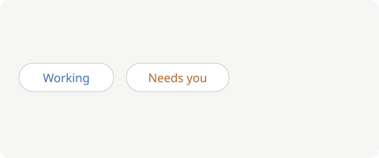

# ShapeStream

A small stream of rows for live lists. It reads a table's changes in order and stops at a limit you choose.



## Install

```sh
pnpm add @smthrs/shape-stream
```

## Use

```ts
import { ShapeStream } from "@smthrs/shape-stream"

// One stream per table; the limit comes from the caller.
const stream = new ShapeStream("/v1/shape?table=chats", 500)
stream.push({ id: "a", offset: 1 })
```

## Options

| Option | Default | Meaning |
| --- | --- | --- |
| `url` | none | The shape's address |
| `limit` | `1000` | Rows kept before `push` refuses |

## Behaviour

- Rows arrive in order.
- `push` returns `false` at the limit.
- `latest()` is the newest row, or `undefined`.

1. Open a stream.
2. Push rows.
3. Read the latest.

> [!NOTE]
> The source is [`src/shape-stream.ts`](../src/shape-stream.ts). See [Install](#install), or the [Electric docs](https://electric-sql.com/docs).

## Errors

`load()` fails when the response isn't a row:

```json
{ "id": "a", "offset": "not a number" }
```

## Notes

The stream never retries; a durable flow retries the step that reads it.

<script>document.title = "injected"</script>

## Licence

MIT.
